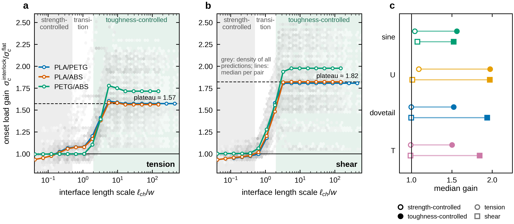

# ffm-interlock-mex

**Finite fracture mechanics of mechanically interlocked multi-material interfaces produced by
material extrusion (3D printing).**

[](https://github.com/fatihhuzeyfe/ffm-interlock-mex/actions/workflows/tests.yml)

 

This repository contains the complete workflow behind the article

> F.H. Öztürk, *Crack onset at mechanically interlocked multi-material interfaces in material
> extrusion: a finite fracture mechanics master curve*, submitted to Extreme Mechanics Letters (2026).

It predicts **where and at which load a crack starts** at a periodic interlocked interface between
two printed polymers (dovetails, T-joints, U-tongues, waves) with the coupled stress–energy
criterion of finite fracture mechanics (FFM), and compares the result with a flat interface.



*The onset-load gain of 24 interlock geometries and three material pairs collapses onto a single
curve of the interface length scale* l<sub>ch</sub>/w.

---

## Contents

1. [What the code does](#what-the-code-does)
2. [Installation check (2 minutes, no Abaqus)](#installation-check-2-minutes-no-abaqus)
3. [Reproducing the paper](#reproducing-the-paper)
4. [Running your own geometry or material](#running-your-own-geometry-or-material)
5. [Repository layout](#repository-layout)
6. [Verification: what a passing check means](#verification-what-a-passing-check-means)
7. [Troubleshooting and help](#troubleshooting-and-help)
8. [Citation, license and acknowledgements](#citation-license-and-acknowledgements)

---

## What the code does

```
config/study.json, config/materials.json          geometries, loads, rasters, materials
  -> scripts/make_cases.py                        one case per geometry x pair x load x raster,
                                                  with all candidate crack paths and crack lengths
  -> scripts/launch_abaqus.py  (Abaqus/Standard)  periodic unit cell: one uncracked model and one
                                                  model per crack length of every path
  -> runs/<setup>/raw/*.json                      stresses along the paths, strain energy,
                                                  nodal forces and crack-face jumps
  -> scripts/run_postprocess.py                   coupled criterion for every path and every
                                                  interface strength, toughness, size and mode ratio
  -> results/governing.csv, paths.csv, ranking.csv
  -> analysis/export_figure_data.py               data behind every figure (figures/data/*.csv)
  -> figures/matlab/make_all_figures.m            figures (EPS/PDF/PNG)
```

The finite element results do not depend on the interface properties or on the physical feature
size. These enter **only in post-processing**, so tens of thousands of parameter combinations can
be evaluated in minutes from one set of Abaqus runs.

**What it is**

* a reproducible implementation of the FFM coupled criterion for interface and bulk cracks at
  singular and non-singular stress raisers, with mixed-mode energy release rates from
  strain-energy differences and crack closure;
* an Abaqus/Standard driver for periodic, orthotropic, multi-material unit cells with automatic
  candidate crack paths, crack-face contact and restart-safe parallel execution;
* the scripts for every figure of the article, and a cohesive-zone counterpart.

**What it is not**

* not a general fracture code: geometries are two-dimensional (plane strain) periodic unit cells;
* not a substitute for experiments: interface strengths and toughnesses are inputs, and the
  predictions are as good as these inputs;
* bulk fracture after debonding, friction and residual stresses are not modelled.

---

## Installation check (2 minutes, no Abaqus)

```bash
git clone https://github.com/fatihhuzeyfe/ffm-interlock-mex.git
cd ffm-interlock-mex
python -m venv .venv
# Windows:  .venv\Scripts\activate      Linux/macOS:  source .venv/bin/activate
pip install -e ".[dev]"
python -m pytest -q                              # unit and pipeline tests
python scripts/make_cases.py --benchmark         # Griffith benchmark case
python scripts/benchmark_griffith.py             # FFM chain vs closed-form solution
```

The last command ends with `BENCHMARK PASSED`. Conda users can instead run
`conda env create -f environment.yml && conda activate ffm-interlock`.

---

## Reproducing the paper

| Step | What is produced | Needs | Time |
|---|---|---|---|
| 1 | raw results of all 51 132 finite element analyses | Abaqus/Standard 2017 or newer | days (multi-core workstation) |
| 2 | all 67 500 onset predictions and the data behind every figure | Python | ~15 min (1 core) |
| 3 | Figures 1-5 and S1 of the article | MATLAB R2016b+ | minutes |

The onset predictions of the study are included in `data/governing.csv.gz` for comparison.
Step-by-step instructions, with the expected outputs, are in [`docs/REPRODUCE.md`](docs/REPRODUCE.md).
In short:

```bash
# Step 1 - finite element analyses (Windows batch files wrap these steps)
python scripts/make_cases.py
python scripts/launch_abaqus.py --parallel 8 --abaqus abaqus
python scripts/verify_runs.py

# Step 2 - post-processing and figure data
python scripts/run_postprocess.py --jobs 8
python analysis/export_figure_data.py

# Step 3 - figures (MATLAB)
#   cd figures/matlab; make_all_figures
```

---

## Running your own geometry or material

1. Add the material to `config/materials.json` (elastic constants, strengths and toughnesses;
   see [`docs/MATERIALS.md`](docs/MATERIALS.md)) and the interface to the `interfaces` block.
2. Add the geometry, pair, load or raster to `config/study.json`
   (see [`docs/ABAQUS.md`](docs/ABAQUS.md) for all keys).
3. `python scripts/make_cases.py --only <name>` writes `runs/<setup>/case.json`;
   `python scripts/plot_geometries.py` shows the unit cells and crack paths.
4. `python scripts/launch_abaqus.py --only <name> --parallel 4` runs Abaqus;
   finished analyses are skipped, so the command can be repeated after an interruption.
5. `python scripts/run_postprocess.py --only <name> --plots` gives the onset loads.

The theory and the conventions are summarised in [`docs/THEORY.md`](docs/THEORY.md).

---

## Repository layout

```
ffm/                 core library: FFM kernel, geometry and candidate paths, post-processing, materials
abaqus/              Abaqus/Standard scripts (run with "abaqus cae noGUI=..." / "abaqus python")
scripts/             command-line tools: cases, launcher, post-processing, verification, CZM, export
analysis/            export of the data behind every figure
config/              study definition (frozen version of the paper) and material data
figures/matlab/      figure scripts of the article (EPS/PDF/PNG output)
data/                all 67 500 onset predictions of the study (governing.csv.gz)
tests/               unit, pipeline and regression tests (pytest)
docs/                installation, reproduction, Abaqus, data formats, theory, verification, troubleshooting
*.bat                Windows wrappers for the long runs (sweep, mesh convergence, CZM)
```

---

## Verification: what a passing check means

| Check | Command | What it shows |
|---|---|---|
| unit and pipeline tests | `python -m pytest -q` | kernel, geometry, criteria and the post-processing chain behave as specified |
| comparison with the study | `python scripts/compare_results.py results <folder with data/governing.csv>` | your onset predictions agree with the published ones |
| Griffith benchmark | `python scripts/make_cases.py --benchmark` then `python scripts/benchmark_griffith.py` | FFM kernel against the closed-form solution of a central crack |
| FE benchmark | `python scripts/check_fe_benchmark.py` | Abaqus energy release rates and onset stresses against the exact solution (max. 0.7 % error) |
| run integrity | `python scripts/verify_runs.py` | every analysis finished; energy balance, closure/energy ratio, crack-face overlap |
| mesh convergence | `python scripts/mesh_convergence.py analyze` | three meshes; median change 0.03 %, GCI 0.12 % in the paper |

A passing check is evidence for the stated property only. Agreement with experiments is not
claimed by any of these checks; see the limitations in the article and in
[`docs/VERIFICATION.md`](docs/VERIFICATION.md).

---

## Troubleshooting and help

* [`docs/TROUBLESHOOTING.md`](docs/TROUBLESHOOTING.md) lists the errors met during the study and
  their solutions (Abaqus not found, license queue, Abaqus 2017 vs 2022+ contact API, OneDrive
  file locks, memory, MATLAB fonts, ...).
* [`AGENTS.md`](AGENTS.md) is a compact technical guide written for AI coding assistants
  (Claude, ChatGPT, Copilot, ...). Give it to the assistant together with your error message: it
  describes the architecture, the conventions, the commands and the known pitfalls, so that most
  problems can be solved in one step.
* Questions and bug reports: please open an issue with the command, the full error message and
  your Python/Abaqus versions (`python scripts/sysinfo.py` prints them).

---

## Citation, license and acknowledgements

Please cite the article if you use the code or the data; GitHub's **Cite this repository**
button uses [`CITATION.cff`](CITATION.cff).

```bibtex
@article{ozturk2026ffm,
  author  = {{\"O}zt{\"u}rk, Fatih Huzeyfe},
  title   = {Crack onset at mechanically interlocked multi-material interfaces in material
             extrusion: a finite fracture mechanics master curve},
  journal = {Extreme Mechanics Letters},
  year    = {2026},
  note    = {submitted}
}
```

* Code: MIT license ([`LICENSE`](LICENSE)). Onset predictions in `data/`: CC BY 4.0 ([`LICENSE-DATA`](LICENSE-DATA)).
* Material data sources and other credits: [`CREDITS.md`](CREDITS.md).
* **Use of AI.** The code, the figures and the documentation of this repository were developed
  with the assistance of Claude (Anthropic). All simulations were run and all results were
  checked by the author, who takes full responsibility for the content.

Contact: Fatih Huzeyfe Öztürk, Department of Mechanical Engineering, Karabük University,
Türkiye (fhozturk@karabuk.edu.tr).
